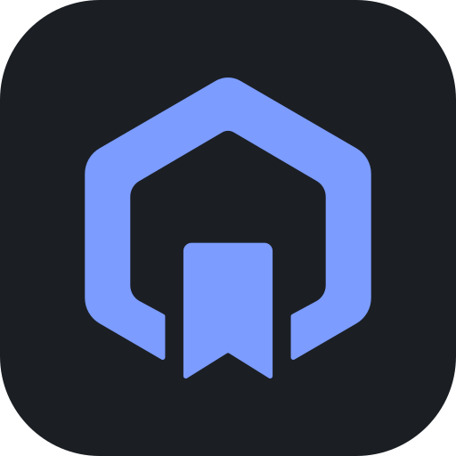

<p align="center">
  
</p>

# Questkeep

[](https://github.com/questkeep/questkeep/releases/latest)
[](https://github.com/questkeep/questkeep/releases)
[](https://github.com/questkeep/questkeep/actions/workflows/ci.yml)
[](https://github.com/questkeep/questkeep/wiki/Installation)
[](https://github.com/questkeep/questkeep/wiki)
[](LICENSE)

A lightweight, extensible game library manager and launcher for **Windows and Linux**, built with
Tauri 2, Rust and SolidJS. Inspired by [Playnite](https://github.com/JosefNemec/Playnite).

> **Status:** v0.\*, early development. Expect rough edges.

**[Read the wiki](https://github.com/questkeep/questkeep/wiki)** for the
[user manual](https://github.com/questkeep/questkeep/wiki/User-Manual) and the
[developer manual](https://github.com/questkeep/questkeep/wiki/Developer-Manual), including
tutorials for writing theme, extension and store plugins.

## Features

- **Steam**: detects installed games across all Steam library folders (Windows registry, Linux
  `~/.steam`, `~/.local/share/Steam`, Flatpak). Tools and runtimes are filtered out. Re-scans
  update entries instead of duplicating them. Imports Steam's own playtime and last played. With
  your Steam Web API key (Settings) it also lists games you own but haven't installed, with an
  Install button.
- **Epic Games, GOG, Xbox / Microsoft Store** (Windows): detects installed games, DLC filtered
  out. Owned-but-not-installed games for these stores need account sign-in and come later.
- **Linux stores**: Epic (via Heroic or Legendary) and GOG (via Heroic) installed games, plus
  **Lutris** games (Steam-runner games are left to the Steam provider). Epic and GOG keep the same
  ids as on Windows. Heroic games start through Heroic; Lutris games through `lutris:rungame/`.
- **Store metadata**: description, release date, developers, publishers, genres and a background
  image from the Steam and GOG stores, fetched slowly in the background.
- **Manual games**: add any executable with arguments, working directory and a cover image.
- **Fast library**: virtualized cover grid or list view that stays smooth with thousands of games;
  as-you-type search; sort by name, last played, playtime or date added; filter by source,
  favorites, hidden and installed.
- **Launch and playtime**: starts games (executables or `steam://` URIs), detects when they stop,
  and records playtime, play count and last played. Sessions survive app exits and crashes.
- **Covers**: taken from local store caches or store CDNs, cached on disk.
- **Keyboard friendly**: arrow keys in the grid, `Enter` for details, `Ctrl+Enter` to play,
  `Ctrl+F` to search.
- **System tray**: closing the window can keep Questkeep running in the tray (the default), with
  your ten most recently played games, your favorites and your installed store clients one click
  away. While in the tray the window is fully closed, so Questkeep uses very little memory.
  Optionally minimize to the tray and start with Windows (minimized to the tray).
- **Portable mode**: put an empty `portable.txt` next to the executable to keep all data in a
  `data/` folder beside it.

## Building from source

Node.js, pnpm and Rust (with clippy, rustfmt and the `wasm32-wasip2` target) are installed and
pinned by [mise](https://mise.jdx.dev) from [mise.toml](mise.toml); see
[Setting up as a contributor](#setting-up-as-a-contributor) at the end. Besides those you need a C
toolchain: the Visual Studio Build Tools on Windows, and on Linux the
[Tauri system dependencies](https://tauri.app/start/prerequisites/) (`libwebkit2gtk-4.1-dev`,
`librsvg2-dev`, ...) plus `libdbus-1-dev` and `pkg-config` (system keyring for store sign-in).

```bash
pnpm install
pnpm dev      # run in development mode
pnpm build    # build a release bundle
pnpm check    # all quality gates (format, lint, types, tests)
```

See [AGENTS.md](AGENTS.md) for the full command list, module map and conventions.

## Data

| | Windows | Linux |
|---|---|---|
| Library database, covers, logs, settings | `%APPDATA%\questkeep` | `~/.local/share/questkeep` |

## Documentation

- [Wiki](https://github.com/questkeep/questkeep/wiki): user manual, developer manual and plugin
  tutorials
- [docs/SPEC.md](docs/SPEC.md): v0.1 specification
- [docs/ARCHITECTURE.md](docs/ARCHITECTURE.md): modules, data model, event flow, measurements
- [docs/DECISIONS.md](docs/DECISIONS.md): decisions and their rationale
- [docs/ROADMAP.md](docs/ROADMAP.md): what's next

## License

MIT, see [LICENSE](LICENSE). Questkeep re-implements ideas from Playnite (MIT), see
[THIRD_PARTY_NOTICES.md](THIRD_PARTY_NOTICES.md).

## Setting up as a contributor

1. **Install [mise](https://mise.jdx.dev)**, which installs the right Node.js, pnpm and Rust:

   Linux and macOS:

   ```bash
   curl https://mise.run | sh
   ```

   macOS with Homebrew: `brew install mise`

   Windows:

   ```powershell
   winget install jdx.mise
   ```

   Then [activate mise in your shell](https://mise.jdx.dev/getting-started.html#activate-mise) and
   open a new terminal.

2. **Run `mise install`** in the repository folder.

3. **Windows only: install the Visual Studio Build Tools** with the C++ workload (needed to
   compile Rust code; mise cannot install it). In an administrator terminal:

   ```powershell
   winget install --id Microsoft.VisualStudio.2022.BuildTools --exact --override "--passive --wait --add Microsoft.VisualStudio.Workload.VCTools --includeRecommended"
   ```

After that, `pnpm install` and `pnpm dev` work.
