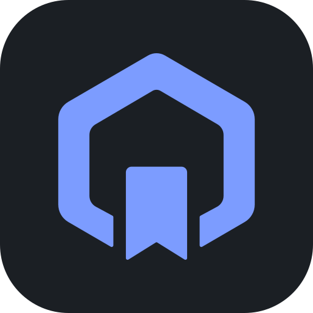

<p align="center">
  
</p>

# Questkeep

A lightweight, extensible game library manager and launcher for **Windows and Linux**, built with
Tauri 2, Rust and SolidJS. Inspired by [Playnite](https://github.com/JosefNemec/Playnite).

> **Status:** v0.1, early development. Expect rough edges.

## Features (v0.1)

- **Steam**: detects installed games across all Steam library folders (Windows registry, Linux
  `~/.steam`, `~/.local/share/Steam`, Flatpak). Tools and runtimes are filtered out. Re-scans
  update entries instead of duplicating them.
- **Manual games**: add any executable with arguments, working directory and a cover image.
- **Fast library**: virtualized cover grid that stays smooth with thousands of games;
  as-you-type search; sort by name, last played, playtime or date added; filter by source,
  favorites, hidden and installed.
- **Launch and playtime**: starts games (executables or `steam://` URIs), detects when they stop,
  and records playtime, play count and last played. Sessions survive app exits and crashes.
- **Covers**: taken from Steam's local cache or the Steam CDN, cached on disk.
- **Keyboard friendly**: arrow keys in the grid, `Enter` for details, `Ctrl+Enter` to play,
  `Ctrl+F` to search.
- **Portable mode**: put an empty `portable.txt` next to the executable to keep all data in a
  `data/` folder beside it.

## Building from source

Requirements:

- Rust (stable) and, on Windows, the Visual Studio Build Tools with the C++ workload
- Node.js 24+ and pnpm 10
- Linux only: the [Tauri system dependencies](https://tauri.app/start/prerequisites/)
  (`libwebkit2gtk-4.1-dev`, `librsvg2-dev`, ...)

```bash
pnpm install
pnpm dev      # run in development mode
pnpm build    # build a release bundle
pnpm check    # all quality gates (format, lint, types, tests)
```

See [AGENTS.md](AGENTS.md) for the full command list, module map and conventions.

## Data

| | Windows | Linux |
|---|---|---|
| Library database, covers, logs, settings | `%APPDATA%\questkeep` | `~/.local/share/questkeep` |

## Documentation

- [docs/SPEC.md](docs/SPEC.md): v0.1 specification
- [docs/ARCHITECTURE.md](docs/ARCHITECTURE.md): modules, data model, event flow, measurements
- [docs/DECISIONS.md](docs/DECISIONS.md): decisions and their rationale
- [docs/ROADMAP.md](docs/ROADMAP.md): what's next

## License

MIT, see [LICENSE](LICENSE). Questkeep re-implements ideas from Playnite (MIT), see
[THIRD_PARTY_NOTICES.md](THIRD_PARTY_NOTICES.md).
